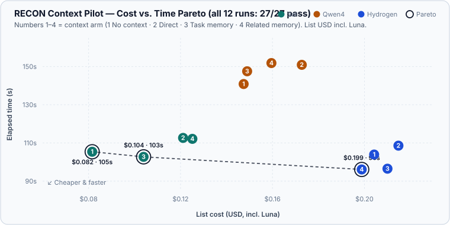

<div align="center">

# P R O J E C T &nbsp; R E C O N

### Retrieval Engine for Context, Organization & Navigation

**AGENTS FORGET. RECON REMEMBERS.**

`// RECON CORE — LOCAL CLI PROTOTYPE`

---

*The mission doesn't end when the session does.*

</div>

## 00 // THE SIGNAL

> **TRANSMISSION RECEIVED**  
> Source: an agent that was here before you.  
> Status: session terminated.  
> Knowledge: **not lost**.

A task begins. An agent explores a repository, traces dependencies, discovers a hidden constraint, makes a decision.

Then the context window fills. The session ends. Another agent arrives.

And the investigation starts all over again.

**RECON is an attempt to break that loop.**

A local-first, harness-independent knowledge and context system for AI-assisted development. Its purpose is to preserve useful discoveries, carry work across sessions, and deliver the *right* context to the *right* agent—without forcing every newcomer to rediscover the same terrain.

<div align="center">

`DISCOVER → RECORD → CONNECT → RETRIEVE → CONTINUE`

</div>

## 01 // MISSION PARAMETERS

| Directive | Objective |
| :-- | :-- |
| **Continuity** | Resume work across conversations, days, and agents. |
| **Precision** | Retrieve relevant evidence, not an entire history dump. |
| **Independence** | Work across compatible coding harnesses, not one vendor. |
| **Integrity** | Preserve provenance, detect contradictions, and prevent silent overwrites. |
| **Efficiency** | Reduce repeated exploration, wasted context, and total task cost. |
| **Accountability** | Measure whether memory actually helps—rather than assuming it does. |

## 02 // MEMORY TOPOLOGY

```text
                  ┌──────────────────────────────┐
                  │       CODING AGENTS          │
                  │  Orchestrator · Implementers │
                  │       Scouts · Reviewers     │
                  └──────────────┬───────────────┘
                                 │
                         CLI / CONTEXT API
                                 │
                  ┌──────────────▼───────────────┐
                  │          RECON CORE          │
                  │     Rust · SQLite · FTS5     │
                  │                              │
                  │  GENERAL KNOWLEDGE           │
                  │  Reusable, curated context   │
                  │                              │
                  │  TASK MEMORY                 │
                  │  Multi-day mission state     │
                  │                              │
                  │  SESSION STATE               │
                  │  Active agent execution      │
                  └──────────────┬───────────────┘
                                 │
                  ┌──────────────▼───────────────┐
                  │       KNOWLEDGE LINKS        │
                  │ Entities · Claims · Evidence │
                  │ Provenance · Relationships   │
                  └──────────────────────────────┘
```

**Design proposal:** a single SQLite source of truth, accessed through a small Rust CLI. Agents request focused context and submit controlled updates. Markdown and HTML are optional exports, not parallel databases.

The first Rust CLI prototype implements scoped memory, retrieval, task checkpoints, and validated Librarian routing. Automatic indexing and model-provider integrations remain future work.

## 03 // THE LIBRARIAN PROTOCOL

A library doesn't need its librarian to memorize every book.

It needs the librarian to know **where to look**.

RECON explores an optional *Librarian* agent: a low-cost semantic navigator that routes ambiguous requests toward relevant entities, tasks, and evidence. Its map can be cached; its answers should be short, grounded, and usually expressed as pointers.

- **Direct lookup:** Rust + SQLite handles known entities and precise searches.
- **Semantic navigation:** the Librarian helps when the request is conceptual, fuzzy, or cross-cutting.
- **Verification:** a Scout can inspect source code or Git *on demand* when a claim needs fresh evidence.
- **Consolidation:** competing observations can coexist until evidence supports a resolution.

The Librarian is **not** the database. The Scout is **not** a permanent Git synchronization daemon. Neither should become a mandatory expense for every simple lookup.

## 04 // KNOWLEDGE WITHOUT AMNESIA

Three agents may independently discover the same function. RECON should not respond by inventing three unrelated functions—or by deleting two useful perspectives.

The proposed knowledge model separates:

```text
ENTITY       one canonical target (function, module, task, decision)
    │
    ├── OBSERVATION A  ── evidence / author / source
    ├── OBSERVATION B  ── evidence / author / source
    └── OBSERVATION C  ── evidence / author / source
              │
         CONSOLIDATED VIEW
         (on retrieval, when safe)
```

Append-only observations preserve contributions. Deterministic deduplication removes exact repetition from the active view. Semantic conflicts remain visible until verified. Nothing becomes true merely because multiple agents repeated it.

## 05 // NO INVISIBLE MAGIC

RECON must justify its own cost.

The proposed evaluation compares agents working with:

1. **Orchestrator-provided context**
2. **No injected context**
3. **RECON context from direct retrieval**
4. **RECON context with Librarian routing**

Repeat each comparable run, report medians, inspect task quality, and count **all** costs—including initial indexing, memory generation, maintenance, retrieval, Librarian calls, and Scout verification.

A memory system that saves 8,000 tokens downstream but spends 12,000 upstream is not automatically a win.

## 06 // FLIGHT STATUS

| System | Status |
| :-- | :-- |
| Multi-harness, Markdown-based task-memory prototype | **Prototype exists; migration decisions pending** |
| Rust CLI + SQLite knowledge core | **Implemented prototype** |
| Structured entity / observation / evidence graph | **Implemented prototype** |
| Versioned Librarian directory and validated routes | **Implemented; model reasoning runs in the calling harness** |
| Targeted evidence freshness checks | **Implemented; semantic Scout verification remains a harness role** |
| Run cost records and audit journal | **Implemented; comparative benchmark trials deferred** |
| GPUI knowledge explorer (read-only first) | **Future** |

Build from source with `cargo build --release --locked`. Start with `target/release/recon --help`.

See [usage and local-state setup](docs/usage.md), the [CLI contract](docs/cli-contract.md), and the [source map](ARCHITECTURE.md). `make check` runs the technical gate. Git contains source; operational knowledge, SQLite databases, and compiled binaries stay local.

The first rule of RECON is simple: **measure before declaring victory**.

The second: **never confuse remembered information with verified truth**.

## 07 // FIRST BENCHMARK PILOT (2026-11-13)

Twelve independent first attempts (`gpt-6.1-sol`, `qwen4-max-preview`, `gemini-4-hydrogen-medium`, all `medium`) across four context arms on a sealed Python CI-wave-planner task, with `gpt-6-luna` (`medium`) as Librarian.



- **Quality:** all 12 runs passed `27/27` sealed acceptance checks and `make check` — even with zero context (Arm 1).
- **Is RECON worth it here?** **Not on this small task.** Because quality was already 100% without context, adding context or RECON mostly increased list USD (`+1.1%` to `+53.5%`) or saved `3–8 s`. `gpt-6-luna` itself cost only `$0.0009–$0.0021` per route (~1% of a run); total cost is driven by the main model's tokens. RECON pays off on harder multi-file tasks where no-context fails or wanders, and on larger corpora where Luna filters noise instead of returning all 5–6 sections.
- **Pareto frontier (Cost USD vs. Time):** `gpt-6.1-sol` Arm 1 (`$0.0815`, `105.4 s`), `gpt-6.1-sol` Arm 3 (`$0.1039`, `102.7 s`), and `gemini-4-hydrogen-medium` Arm 4 (`$0.1988`, `96.1 s`).

See the full measurements, list-price conversions, and shared setup costs in [docs/benchmarks/2026-11-13-ci-waves-pilot.md](docs/benchmarks/2026-11-13-ci-waves-pilot.md).

---

<div align="center">

### PROJECT RECON

**One mission. Many agents. No lost context.**

`// END TRANSMISSION — CONTINUITY PRESERVED`

</div>
