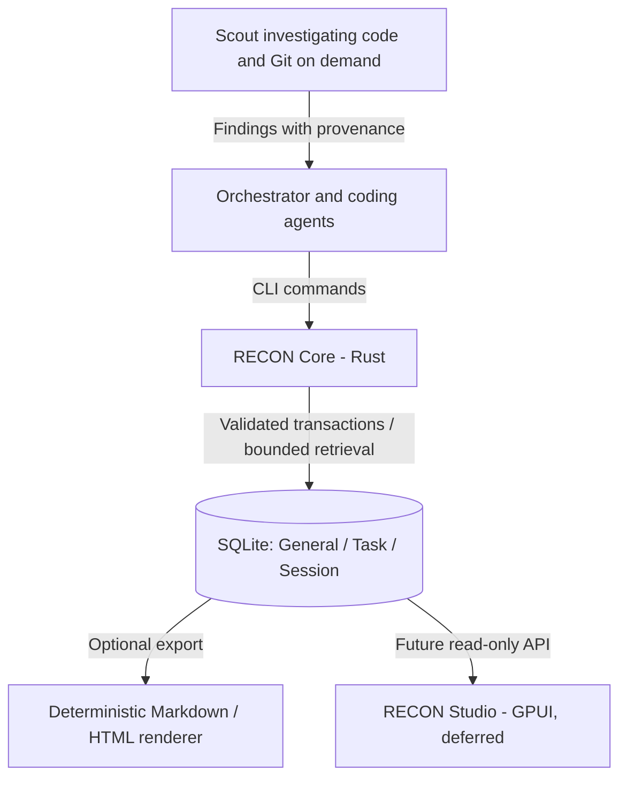

# Project RECON — Architecture Annex 01
## CLI-first Rust Core, SQLite Memory, and Optional Visualization

**Status:** Discussion notes / proposed direction, not an implementation specification  
**Date:** 2026-11-13  
**Relationship to existing material:** Addendum to `shared-brain-multi-harness.zip`; does not modify or replace its current Markdown-based MVP.

## 1. Context and intent

The existing ZIP describes a small, cross-harness task-memory prototype: `AGENTS.md` instructions, a `task-memory` skill, `.tasks/<task-id>.md` task records, Scout investigations, checkpoint/resume/handoff, and `task_guard.py`. It intentionally has **no SQLite, server, or MCP**. `CITESTE-MA.md` explicitly mentions *Engram via CLI or a custom broker* as a possible later stage.

The RECON proposal explores that later stage without committing to implementation now. The working name is **Project RECON — Retrieval Engine for Context, Organization & Navigation**.

**Primary objective:** deliver relevant, trustworthy, reusable context to coding agents across harnesses, tasks, and days, while minimizing unnecessary tokens, repeated investigations, operational overhead, and data-integrity risks.

## 2. Proposed architectural decision

**CLI-first, MCP-free by default.** Build a small Rust executable (`recon`) backed by SQLite and accessible through the shell tools already present in supported coding harnesses.

- No mandatory MCP server, graphical process, web server, or continuously running AI agent.
- Harness integration through thin instruction/skill adapters; avoid SDK-specific business logic.
- SQLite is the proposed authoritative operational store *after migration*. During the existing MVP, Markdown remains authoritative; no mixed-authority state without a formal transition.
- The Rust Core validates all mutations, provides retrieval, and assembles bounded context packages.
- Agents do **not** receive unrestricted SQL write access. They use a stable CLI contract.
- Git remains owned by ordinary Scout/code-investigation workflows and is consulted when needed; RECON does not create a separate automatic Git-tracking subsystem.

**Important qualification:** A CLI command still uses the harness's shell-execution tool. CLI avoids a dedicated MCP surface, but not all tool calls, and its token savings must be measured rather than assumed.

## 3. Logical memory scopes

| Scope | Purpose | Typical lifetime | Updates |
| --- | --- | --- | --- |
| **General Brain** | Reusable conventions, validated architecture knowledge, durable relationships | Weeks to years | Periodic consolidation, e.g. every few days |
| **Task Brain** | Decisions, findings, blockers, progress, handoff across multiple days and harnesses | Days to weeks or longer | On meaningful task events, checkpoint, and handoff |
| **Session State** | Current execution context and short-lived coordination | One session or invocation | As needed; expire or archive safely |

These are **logical scopes**, not necessarily separate databases or services. The Task Brain is not the same thing as a single chat session. A multi-day Jenkins-to-GitHub-Actions migration should preserve its task identity and resume point across harnesses.

## 4. Read/write and export flow



**Normal agent workflow:** agents read and write via CLI -> Core -> SQLite. They do not separately read generated Markdown/HTML exports as a second context source. This prevents duplicate memory delivery and two competing sources of truth.

**Human-readable history:** prefer a navigable activity/event journal plus selective export, instead of regenerating large documents continuously. Export to Markdown or HTML only on request or at configured milestones. Structured export can be deterministic and use zero LLM tokens; a small model is optional only for semantic summaries or prose rewriting.

## 5. Candidate CLI interactions (illustrative, not finalized)

```bash
recon task resume migrare-ci --budget 1200
recon context get --task migrare-ci --query "shared build artifacts" --budget 2000
recon memory add --task migrare-ci --type finding --input finding.json
recon checkpoint --task migrare-ci --input checkpoint.json
recon journal --task migrare-ci --limit 20
recon export --task migrare-ci --format markdown
```

These are **examples of desired operations**, not commands implemented by the ZIP. Machine-readable input/output schemas and command names are open design questions.

Possible retrieval behavior: return a concise task checkpoint first; allow targeted expansion of decisions, blockers, provenance, and relationships. A `--budget` flag must correspond to a measured/estimated model-token budget or explicitly report its approximation. Querying SQLite itself does not consume model tokens; transferring large query results into a model context does.

## 6. Safety and integrity principles

- SQLite transactions, foreign-key constraints, schema migrations and tested backups handle database integrity; consider WAL for read/write concurrency where appropriate.
- Separate **technical corruption** (invalid database) from **semantic corruption** (false claims, outdated conclusions, conflicting decisions).
- Save provenance for factual claims: repository path, symbol, file hash/commit when available, producing agent, task, and verification status.
- Use append-only event records for important decisions and transitions; avoid destructive overwrites of evidence. Keep materialized current state as a derivation when useful.
- Concurrency requires application-level optimistic version checks or conflict resolution: SQLite atomicity does not guarantee two agents agree semantically.
- Avoid unauthorized cross-task disclosure, raw secrets, and unbounded response bodies.
- Scout verifies code/Git on demand, rather than forcing full repository scans on every memory access.

## 7. GPUI / graphical visualization — future, not MVP

A possible **RECON Studio** could use Rust + GPUI to display an Obsidian-like context graph, with n8n-like node selection/inspection. Its first version would be **strictly read-only**, ideally using a read-only Core interface/connection rather than merely hiding editing controls. Later, editing could be considered through the same validated Core operations used by agents. Web-hosted visualization is another optional future adapter.

**Explicit decision:** defer GPUI, graphical editing, and the web viewer. They must not become dependencies of RECON Core.

## 8. What changes and what does not

**Existing ZIP remains unchanged:** `.tasks` Markdown, `AGENTS.md`, skills, and adapters continue to define its current working MVP. This annex is a possible future evolution, **not** an instruction for Codex to migrate the repo immediately.

**Potential future migration:** import or preserve existing task history; choose a clean authority cutover; keep Markdown export as interoperability/backup rather than a bidirectionally synchronized second store.

## 9. Open questions for discussion (not yet decided)

1. **Invocation model:** start a short-lived `recon` process for each CLI command, or use an optional resident broker only if performance measurements justify it?
2. **Agent concurrency:** how do two agents working on the same task submit updates without losing one another's decisions? Event append, version/CAS, or a single-writer queue?
3. **Task identity:** branch-derived default IDs versus explicit task IDs and multiple concurrent tasks per branch.
4. **Context contract:** minimal fields, retrieval ranking, token accounting, and provenance format for each harness.
5. **Consolidation:** which events move from Task Brain to General Brain, and who verifies contradictions?
6. **Metrics:** benchmark latency, memory, actual prompt tokens, repeated investigations, stale-context incidents and recovery behavior against the original Markdown-only MVP.
7. **Recovery and portability:** database backups, export/import, cross-machine sharing, corruption recovery and schema migration.

## 10. Working hypothesis

**RECON Core = Rust CLI + SQLite + validated retrieval/write operations.**  
**Harnesses = thin instructions/adapters, no mandatory MCP.**  
**Scout = code and Git investigation when required.**  
**Humans = journal and optional exports today; read-only graph visualization later.**

Keep these ideas as annex material until architectural discussion concludes. Do not rewrite the original implementation plan or treat proposed commands as working features.