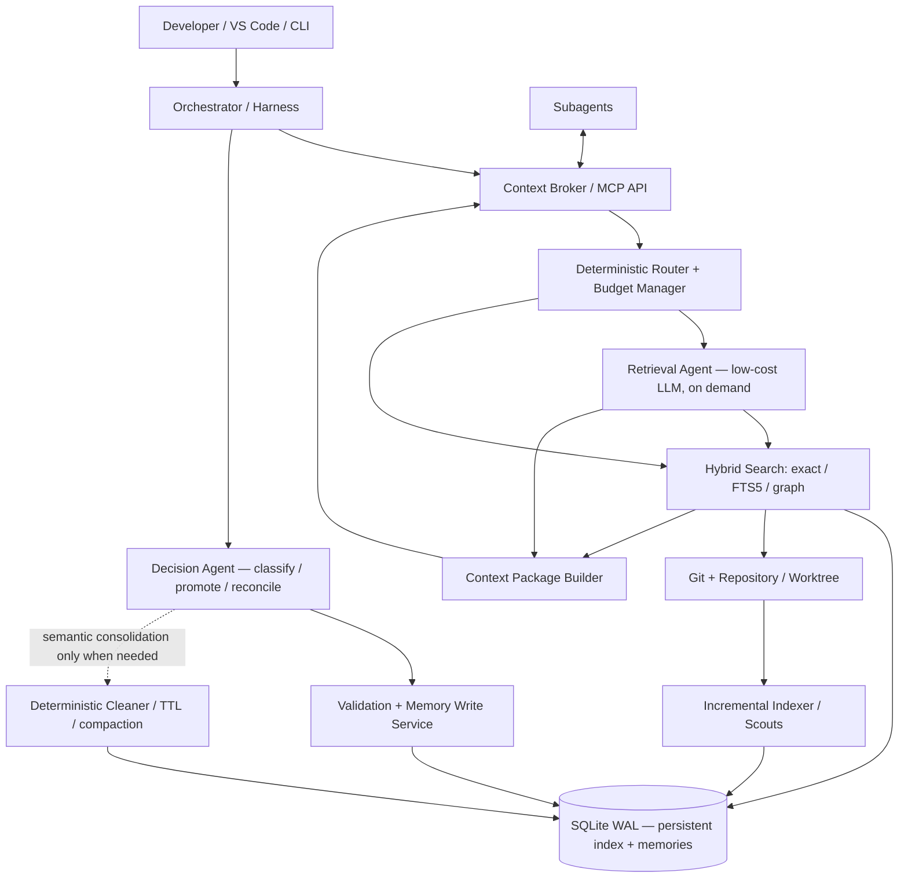

# Shared Brain — Context & Knowledge Infrastructure for Multi-Agent Coding

**Design draft:** v0.1  
**Data:** 13 noiembrie 2026  
**Status:** Explorare arhitecturală; deciziile sunt propuneri, nu implementare finală.  
**Context:** VS Code / coding harnesses / orchestrator + subagenți, cu aplicabilitate inițială în repository-uri software automotive (AUTOSAR, Reprog, DCM, NvM, Crypto, linker scripts) și posibilitate de utilizare generală.

---

## 1. Ideea de bază

Construim un **Shared Brain** independent de IDE și de harness: un sistem de indexare, memorie și distribuție de context, accesibil atât orchestratorului, cât și subagenților. Scopul nu este să țină întregul repository în contextul unui model, ci să-i livreze fiecărui agent **doar informația necesară, validă și trasabilă**, la cost mic.

Problema observată: subagenții nu moștenesc obligatoriu întregul context al orchestratorului. Ei repetă explorări de repository, reiau investigații deja făcute, ratează constrângeri și cresc costul, latența și riscul de eroare.

**Teza:** plătim o indexare inițială semnificativă, apoi amortizăm costul prin reutilizare între agenți și între sesiuni. Reducerea costului recurent cu ~60%, eventual cu un compromis de ~10% la performanța sarcinilor, este o **ipoteză de evaluat**, nu o promisiune. Trebuie comparate și scenariile în care performanța crește, prin eliminarea repetărilor și prin context mai precis.

### Principii de design

1. **Pointer-first:** referințe la fișiere, simboluri, intervale de linii, commituri, module și dovezi, nu duplicarea integrală a codului.
2. **Context on demand:** pachete mici, extensibile progresiv, cu buget explicit de tokenuri.
3. **Persistent + episodic:** faptele utile supraviețuiesc sesiunilor; încercările intermediare expiră.
4. **Git este sursa de adevăr a istoricului codului**, nu reconstruim Git într-o bază proprie.
5. **Graful modelează structură + relații + evoluție**, dar „a treia dimensiune” temporală poate fi calculată la cerere din Git și din proveniența memoriei.
6. **Deterministic before AI:** căutarea exactă, hash-urile, invalidarea și curățarea simplă nu necesită model.
7. **AI ieftin ≠ neapărat model de puțini parametri:** criteriul real este costul total per task, calitatea, latența și compatibilitatea cu tool-urile.
8. **Fără write-back necontrolat:** ipotezele agenților nu se transformă automat în adevăr persistent.
9. **Izolare:** repository, branch, worktree, sesiune, agent, drepturi și clasificarea datelor.
10. **Observabilitate:** trebuie să putem demonstra economia și corectitudinea, nu doar să presupunem.

---

## 2. Ce înseamnă „3D” aici

Nu este obligatorie o bază de date geometric tridimensională. Modelăm trei perspective peste același set de noduri și relații:

- **Vertical — ierarhie / structură:** `Automotive → Modules → Reprog → Component → Function / Configuration / Symbol`.
- **Orizontal — dependențe:** Reprog comunică cu DCM, NvM, Crypto, bootloader, UDS, linker etc. Pot exista relații de tip `calls`, `configures`, `depends_on`, `uses_memory_region`, `implements_protocol`, `tested_by`.
- **Temporal — evoluție:** ce s-a schimbat față de un commit/release/baseline; cum afectează schimbarea faptele și relațiile cunoscute. În MVP, generăm această vedere folosind Git + snapshot-ul indexului, nu păstrăm copii complete ale grafului pentru fiecare commit.

**Important:** un arbore singur nu este suficient. Aceeași entitate poate aparține unui modul, dar depinde transversal de alte module. Graful este un set de noduri și muchii tipizate; ierarhia este doar unul dintre tipurile de relații.

### Exemplu

```text
Automotive
└── Modules
    ├── Reprog
    │   ├── BootSequence
    │   ├── FlashRoutine
    │   └── LinkerConfiguration
    ├── DCM
    ├── NvM
    └── Crypto

Reprog --uses_service--> DCM
Reprog --persists_state_via--> NvM
Reprog --verifies_image_via--> Crypto
LinkerConfiguration --defines--> FlashRegion

Timp: git diff(BASE..HEAD) → symbols/edges potentially impacted
```

Observație: UDS este un protocol; DCM este un modul. Modelul trebuie să evite confuzia dintre tipurile de entități.

---

## 3. Arhitectură propusă



### Componente

| Componentă | Responsabilitate | AI necesar? |
|---|---|---|
| Context Broker | Contract unic pentru harness-uri; autentificare, bugete, pachete de context, trasee | Nu |
| SQLite Knowledge Store | Entități, relații, memorie, proveniență, sessions, cache | Nu |
| Repository Indexer | Inventar de fișiere, simboluri, linkuri, hash-uri și parsare incrementală | Predominant nu; scouts AI pentru semantică complexă |
| Retrieval Router | Exact lookup → FTS → graph → agent, după cost și încredere | Nu |
| Retrieval Agent | Dezambiguizare, plan de căutare, selecție de fragmente și sinteză scurtă | Da, model ieftin |
| Decision Agent | Clasifică descoperiri, decide propuneri de promovare și rezolvă contradicții | Da, model ieftin, la nevoie |
| Memory Writer | Validare schema, provenance, dedup, concurență, statut de încredere | Nu |
| Cleaner / Garbage Collector | TTL, compaction, ștergere cache, arhivare, pin/refcount | Nu pentru routine; AI la consolidări |
| Git Adapter | Diff/log/show/merge-base, identificare schimbări | Nu |
| Metrics/Evaluation | Cost, tokenuri, latență, hit-rate, erori și acuratețe | Nu |

**Nu avem nevoie de un proces LLM „awake” permanent.** Putem ține serviciul disponibil și încărca/invoca modelul numai când apare o cerere. Tool stripping reduce descrierile incluse în prompt, dar costul real depinde de prompt, caching, buget și numărul de pași. Pentru API-uri facturate per token, o sesiune inactivă nu este automat o sursă de cost.

---

## 4. Stocare: de ce SQLite la început

SQLite este potrivit pentru MVP: embedded, zero operațiuni de cluster, tranzacții, query-uri relaționale, `FTS5` pentru căutare textuală, JSON și `WAL` pentru mai mulți cititori simultani. Graful poate fi reprezentat prin `nodes` și `edges` și interogat inclusiv cu CTE-uri recursive. La început nu este nevoie de Neo4j.

**Limite:** un singur writer activ la un moment dat, concurență la scriere, traversal-uri sofisticate/întinse mai dificile; dacă sistemul devine multi-host sau voluminos, se reevaluează Postgres/graph DB. `WAL` nu înseamnă că mai multe procese pot scrie simultan fără blocaje. Pentru MVP este recomandat un serviciu unic de write, `busy_timeout`, batch-uri și tranzacții scurte.

### Schemă logică inițială

| Tabel | Câmpuri cheie | Rol |
|---|---|---|
| `repositories` | `id`, `root_uri`, `remote_fingerprint`, `default_branch`, `created_at` | Identitate repo; fără a presupune unicitatea numelui folderului |
| `repo_revisions` | `id`, `repo_id`, `commit_sha`, `tree_sha`, `indexed_at`, `indexer_version` | Starea indexată și reproductibilitatea |
| `nodes` | `id`, `repo_id`, `kind`, `canonical_key`, `name`, `parent_id`, `attributes_json` | Module, funcții, fișiere, simboluri, protocol etc. |
| `edges` | `id`, `repo_id`, `from_node`, `to_node`, `relation`, `evidence_id`, `confidence`, `status` | Dependențe, call graph, configurări, ierarhie |
| `source_spans` | `id`, `repo_id`, `path`, `symbol`, `start_line`, `end_line`, `content_hash`, `revision_id` | Pointeri verificabili către surse |
| `sessions` | `id`, `repo_id`, `base_revision_id`, `started_at`, `closed_at`, `status` | Memorie episodică |
| `agent_tasks` | `id`, `session_id`, `agent_id`, `parent_task_id`, `goal`, `status`, `created_at` | Delegare și cooperare |
| `memories` | `id`, `scope`, `session_id`, `repo_id`, `subject_node_id`, `type`, `content`, `confidence`, `status`, `pinned`, `created_at`, `last_verified_at`, `expires_at` | Fapte, decizii, ipoteze, concluzii |
| `memory_evidence` | `memory_id`, `source_span_id`, `commit_sha`, `evidence_kind` | Proveniență verificabilă many-to-many |
| `cache_entries` | `key`, `repo_id`, `revision_fingerprint`, `query_type`, `payload`, `created_at`, `expires_at`, `status` | Rezultate reutilizabile |
| `cache_dependencies` | `cache_key`, `node_id`, `source_span_id`, `content_hash` | Invalidare fină |
| `memory_events` | `id`, `memory_id`, `action`, `actor`, `reason`, `timestamp`, `before_hash`, `after_hash` | Audit și consolidare |
| `index_jobs` | `id`, `repo_id`, `from_commit`, `to_commit`, `status`, `error`, `started_at`, `completed_at` | Actualizări incrementale sigure |

### SQL minimal ilustrativ (nu schemă de producție completă)

```sql
PRAGMA journal_mode = WAL;
PRAGMA foreign_keys = ON;
PRAGMA busy_timeout = 5000;

CREATE TABLE repositories (
  id TEXT PRIMARY KEY,
  root_uri TEXT NOT NULL,
  remote_fingerprint TEXT,
  created_at TEXT NOT NULL
);

CREATE TABLE nodes (
  id TEXT PRIMARY KEY,
  repo_id TEXT NOT NULL REFERENCES repositories(id),
  kind TEXT NOT NULL,
  canonical_key TEXT NOT NULL,
  name TEXT NOT NULL,
  parent_id TEXT REFERENCES nodes(id),
  attributes_json TEXT NOT NULL DEFAULT '{}',
  UNIQUE(repo_id, canonical_key)
);

CREATE TABLE edges (
  id TEXT PRIMARY KEY,
  repo_id TEXT NOT NULL REFERENCES repositories(id),
  from_node TEXT NOT NULL REFERENCES nodes(id),
  to_node TEXT NOT NULL REFERENCES nodes(id),
  relation TEXT NOT NULL,
  confidence REAL CHECK(confidence BETWEEN 0 AND 1),
  status TEXT NOT NULL DEFAULT 'active'
);
CREATE INDEX idx_edges_from ON edges(repo_id, from_node, relation);
CREATE INDEX idx_edges_to ON edges(repo_id, to_node, relation);

CREATE TABLE memories (
  id TEXT PRIMARY KEY,
  repo_id TEXT NOT NULL REFERENCES repositories(id),
  session_id TEXT,
  subject_node_id TEXT REFERENCES nodes(id),
  scope TEXT NOT NULL CHECK(scope IN ('task','session','repository')),
  type TEXT NOT NULL,
  content TEXT NOT NULL,
  confidence REAL CHECK(confidence BETWEEN 0 AND 1),
  status TEXT NOT NULL DEFAULT 'candidate',
  pinned INTEGER NOT NULL DEFAULT 0,
  created_at TEXT NOT NULL,
  last_verified_at TEXT,
  expires_at TEXT
);
CREATE VIRTUAL TABLE memory_fts USING fts5(content, content='memories', content_rowid='rowid');
-- Sincronizarea FTS (triggers / rebuild) trebuie implementată explicit.
```

**Notă despre chei:** simbolurile și funcțiile se pot muta/redenumi. `canonical_key` identifică o entitate în versiunea indexului, nu garantează identitate semantică eternă. Mutările și rename-urile se tratează explicit, cu evidență și eventual `aliases`.

---

## 5. Fluxuri operaționale

### 5.1 Bootstrap inițial (cost upfront)

1. Detectare repository-uri, worktree-uri, limbaje, build systems, module, configs și constrângeri.
2. Indexare deterministă: fișiere, hashes, symbols, imports/includes, build deps; preferăm parsere (Tree-sitter / LSP / AST / compiler metadata) înainte de LLM.
3. Scouts specializați cercetează zonele insuficient înțelese: Reprog, DCM, NvM, Crypto, linker, test harness.
4. Scouts publică **candidați** de cunoștințe, fiecare cu dovezi exacte (fișier, simbol, linii, commit).
5. Decision/validation verifică și promovează faptele bune în `repository memory`.
6. Construim indexul FTS și relațiile; pregătim rezumate mici pentru noduri importante.
7. Memorizăm baseline-ul Git (`HEAD`, tree hash, configurația indexerului).

**Limitare:** bootstrap-ul poate fi scump; trebuie un mod `fast scan` și unul `deep research`, cu prioritizare pe zonele folosite des.

### 5.2 Cerere de context — exemplul linkerului

Input:

```json
{
  "repo": "repo-id",
  "task": "Explain memory layout and linker effects on Reprog",
  "scope": ["Reprog", "linker"],
  "commit": "HEAD",
  "max_tokens": 900,
  "evidence_required": true
}
```

Flux:

1. Router verifică dacă query-ul are un rezultat valid și proaspăt în cache.
2. Dacă nu, caută exact în symbols/spans, apoi în FTS5, apoi traversează muchii relevante.
3. Agentul mic intră numai dacă trebuie dezambiguizare, extindere selectivă sau sinteză.
4. `read_code_slice` extrage **strict** fragmentele indicate de pointeri (nu întreg repository-ul).
5. Agentul returnează un `Context Package`: concluzii scurte, linkuri la surse, nivel de încredere, commit, informații lipsă.
6. Orchestratorul poate cere expansiune treptată (de exemplu 900 → 2.500 → 5.000 tokenuri) doar dacă este util.

Output ilustrativ:

```json
{
  "summary": "Reprog uses the flash region declared by linker configuration ...",
  "facts": [
    {"text": "...", "confidence": 0.91, "evidence": ["src/linker/app.ld:60-88@<sha>"]}
  ],
  "related_nodes": ["Reprog", "FlashRegion", "DCM"],
  "revision": "<sha>",
  "staleness": "verified_at_revision",
  "token_estimate": 650,
  "next_queries": ["expand_flash_region", "show_diff"]
}
```

**Regulă:** o referință de linie poate deveni invalidă după modificări; la fetch verificăm commitul/hash-ul și re-localizăm simbolul dacă este cazul.

### 5.3 New session / Git incremental

1. Citim `HEAD`, branch/worktree și ultimul commit indexat pentru acel context.
2. Comparam tree-ul/indexul cu working tree; `git diff` pentru modificări; `git log` / `git show` la nevoie. **`git fetch` doar dacă avem nevoie să sincronizăm remote-ul și există permisiune.**
3. Identificăm fișiere și simboluri schimbate; actualizăm indexul local.
4. Traversăm relațiile de dependență și marcăm cache/memorii drept `stale` sau `needs_verification` în mod conservator.
5. Reconsolidăm semantic numai zonele afectate.
6. La request, Retrieval Agent poate compara „ce știa sistemul la baseline” cu „ce există acum”.

**Git branches:** nu comparați două commituri exclusiv după timestamp; folosiți ancestry/merge-base și tree hashes. Suportați worktree cu modificări necomise; `HEAD` singur nu descrie întotdeauna starea reală.

### 5.4 Concurență și single-flight

Dacă 10 subagenți cer aceeași explorare:
- calculați o cheie `repo + revision/tree + worktree fingerprint + query intent + retrieval policy version`;
- o singură cerere execută cercetarea (`in-flight`); ceilalți așteaptă / primesc rezultat reutilizabil;
- timeout și anulare; nu propagați erori temporare ca rezultate persistente;
- la schimbarea dependențelor, invalidați rezultatul.

**Important:** două cereri similar formulate nu sunt automat echivalente semantic. Cache-ul exact și cache-ul semantic trebuie separate, cu reguli de validare diferite.

---

## 6. Contractul Context Broker / MCP

### API conceptual

| Operație | Scop |
|---|---|
| `context.get(request)` | Compune un context package sub bugetul cerut |
| `context.expand(package_id, focus, extra_tokens)` | Adaugă dovezi/fragmente relevante, fără refetch integral |
| `memory.search(query, scope)` | Caută memorii validate și candidate, segregate |
| `graph.neighbors(node_id, relation_types, depth)` | Traversează relații cu depth/size limit |
| `source.read(span_id, revision)` | Citește linii exacte după verificarea versiunii |
| `git.changes(repo_id, from, to, paths?)` | Diff local și module/simboluri schimbate |
| `memory.propose(fact, evidence, session)` | Publică un candidat, nu un adevăr definitiv |
| `memory.promote(memory_id, reason)` | Operație controlată, cu audit |
| `session.close(session_id)` | Consolidare și expire policy |
| `index.status(repo_id)` | Baseline, backlog, freshness |

**MCP** este o opțiune de integrare. Nu toate harness-urile transmit contextul sau permisiunile la fel. Verificăm concret ce tool-uri pot apela agentul principal și subagenții; fallback: CLI/HTTP local sau fișiere workspace bine structurate.

### Politică de pachete

Un context package trebuie să includă: `task`, `scope`, `revision`, `summary`, `facts`, `evidence`, `contradictions`, `unknowns`, `confidence`, `token_estimate`, `expires_when`, `expand_handles`.

Setări inițiale **orientative** (de validat prin benchmark):
- simple lookup: 200–600 tokenuri;
- task uzual: 600–1.500;
- analiza impactului: 1.500–4.000;
- extindere la cerere: până la limita impusă de orchestrator.

Nu confundăm context window maxim al unui model cu un buget optim de retrieval.

---

## 7. Strategy pentru Retrieval Agent și Decision Agent

### Retrieval Agent

Un model cu **cost per task mic**, viteză bună și fiabilitate la tool calling; nu ne interesează doar numărul de parametri. Exemple de candidați de evaluat sunt variantele „Haiku”/modele ieftine disponibile în harness sau API. **Nu fixăm aici prețuri, nume de versiuni și benchmarkuri nevalidate**: acestea se verifică la implementare, inclusiv taxarea cache-ului și a contextului lung.

**Tool-uri strict permise:** `search_memory`, `search_symbols`, `graph_neighbors`, `read_code_slice` (eventual `git_changes` prin broker). `publish_context` poate fi funcție a brokerului, nu tool cu write arbitrar. Fără shell universal și fără editarea codului.

**Sarcini:** selectează strategia de căutare, dezambiguizează, combină 2–5 dovezi și întoarce un răspuns compact; nu decide singur corectitudinea unei modificări complexe de linker.

### Decision Agent

Invocat la evenimente, nu obligatoriu permanent. Clasifică informația ca:
- `ephemeral` — rezultatul unei încercări;
- `candidate` — observație nouă, neverificată;
- `verified_fact` — confirmată de dovezi;
- `decision` — alegere de arhitectură asumată;
- `constraint` — regulă importantă a proiectului;
- `superseded` / `disputed` — invalidată sau controversată.

AI poate propune consolidare/deduplicare și promovare; **writer-ul determinist aplică validările, verifică drepturile și înregistrează auditul**. Pentru decizii de produs/soluție, confirmarea orchestratorului sau utilizatorului poate fi necesară.

### Cleaner / GC

Reguli deterministe: TTL, LRU pentru cache, eliminare duplicate identice, limite per-scope, refcounts, pin, protejare taskuri active. Consolidarea semantică prin model se declanșează doar când sunt suficiente date și câștig potențial.

**Nu ștergem** automat `pinned`, memorii legate de taskuri active, decizii fără înlocuitor sau dovezi necesare auditului. Arhivare/tombstones înainte de ștergerea definitivă, unde merită.

---

## 8. Compresie și caching

### Compresia

- `gzip`/`zstd` reduc bytes pe disc/rețea și pot comprima artefactele raw, **nu reduc automat tokenurile consumate de LLM** după decomprimare.
- Compresia de context adevărată este **semantică**: dedup, abstractizare, rezumat, separarea factelor de dovezi și recuperare progresivă.
- Nu lăsăm un rezumat fără legătură la sursă; altfel apar halucinații greu de auditat.
- Unele tool responses foarte mari merită păstrate comprimate și indexate, nu reinjectate integral.

### Niveluri logice ale cache-ului

| Nivel | Conținut | Viață |
|---|---|---|
| L0 | Context deja furnizat agentului/taskului | Task |
| L1 | Context packages și rezultate de retrieval | Sesiune / TTL |
| L2 | Rezumate validate, memorie și index semantic | Repo persistent |
| L3 | Codul și istoricul în Git, source of truth | Durata repo-ului |

Acestea sunt **niveluri conceptuale**, nu cache-uri hardware sau un standard de nomenclatură.

Invalidare prin `(repo, revision/worktree, dependency hashes, index schema/version, retrieval policy)`. Hash de conținut ajută la identificarea modificărilor; Git commit singur nu ajunge când există modificări necomise.

---

## 9. Securitate, integritate și domenii sensibile

- Codul repository-ului, comentariile și documentele pot conține **prompt injection**. Sunt date neîncredere, nu instrucțiuni pentru agent.
- API de acces read-only implicit; write-back prin serviciu controlat și jurnalizat.
- Izolare între clienți/repository-uri/branch-uri; nu amestecăm accidental memorii.
- Respectăm politica organizației privind trimiterea codului la modele cloud; posibil modelele locale sau endpoint-uri aprobate.
- Nu includem secrete, chei, tokenuri sau date personale în context packages; redaction înainte de indexare și publicare.
- Pentru automotive, un rezumat despre memory maps sau flash routines nu înlocuiește verificarea în cod, build și teste.
- Scope și provenance obligatorii; `confidence` nu este probabilitate calibrată fără evaluare.

---

## 10. Evaluare: testăm ipoteza de −60%

### Set de taskuri

Selectăm aproximativ 50–100 taskuri reale și repetabile din repository: localizarea unor funcții, explicarea unui linker script, analiza dependențelor Reprog–DCM–NvM, „ce s-a schimbat între baseline și HEAD?”, identificarea impactului unei modificări, urmărirea unor configurații și erori de build/test.

**Comparăm:**
1. Baseline: orchestrator + subagenți fără Shared Brain.
2. Shared Brain cu index determinist și FTS/graph, fără Retrieval LLM.
3. Shared Brain + Retrieval Agent ieftin.
4. Variante cu/ fără Memory Consolidator și politici diferite de caching.

**Metrice:** cost API total (input/output/cache), tokenuri totale și per task, latență p50/p95, număr de tool calls, duplicate reads, cache hit rate, corectitudine verificată pe ground truth, grad de acoperire, stale answer rate, recovery după schimbări Git.

### Amortizare

Dacă bootstrap costă `B`, o sesiune fără sistem costă `C`, iar noua sesiune costă `r*C` (de exemplu `r=0.4` pentru 60% economii):

`break_even_sessions = B / ((1-r)*C)`

**Exemplu pur ipotetic:** `B = 10*C`, `r = 0.4` → `10 / 0.6 ≈ 16.7`, deci amortizare după ~17 sesiuni. Adăugăm costurile de reindexare, stocare, modelul de retrieval și cache misses pentru un calcul real.

Pierdere acceptabilă de performanță: trebuie definită prin **quality/accuracy/coverage**, nu printr-un procent vag. O economie de tokenuri cu răspunsuri incorecte nu este un succes.

---

## 11. MVP / roadmap

### Faza 0 — spike tehnic (cel mai mic experiment)

- Un singur repository, un singur worktree, read-only.
- SQLite (`nodes`, `edges`, `source_spans`, `memories`, `sessions`).
- Indexare basic de fișiere, simboluri și includes; FTS5.
- Interfață `context.get` în CLI sau MCP.
- 20 de întrebări reale, cu răspunsuri de referință, măsurăm baseline vs broker.

### Faza 1 — agenți și context packages

- Retrieval Router determinist, Retrieval Agent cu tool-uri restrânse.
- Pachete cu buget de tokenuri, dovezi și `expand`.
- Reutilizare cross-subagent, single-flight și sesiuni.

### Faza 2 — memorie durabilă

- Decision Agent, promotare controlată, dedup, audit, cleanup și TTL.
- Învățare între sesiuni, cu provenance.

### Faza 3 — Git incremental și impact analysis

- Actualizare la diferențe Git, hash-uri de conținut, working tree dirty.
- Invalidare selectivă, recitire pe simboluri, traversare impact.
- Replay/analize istorice la cerere, fără snapshot complet per commit.

### Faza 4 — integrare multi-harness și observabilitate

- Copilot/VS Code și alte harness-uri unde accesul la tool-uri o permite.
- Dashboard: cost amortizat, căutări economisite, stale memories și contradicții.
- Extindere multi-repo/worktree, numai după validarea beneficiului.

---

## 12. Decizii provizorii vs întrebări deschise

### Direcții agreate în conversație

- Shared Brain comun, nu copierea contextului orchestratorului în toți subagenții.
- Informațiile valoroase trebuie să supraviețuiască sesiunilor.
- Indexare inițială prin scouts, apoi update incremental.
- SQLite candidat principal pentru MVP.
- Graf ierarhic + relații transversale + timp prin Git.
- Retrieval separat, cu model ieftin, puține tool-uri și context foarte mic.
- Cleaner eficient; nu creștem necontrolat memoria.
- Costul upfront este acceptabil dacă economia recurentă este demonstrabilă.

### Întrebări pentru sesiunea următoare

1. **Harness integration:** Copilot Chat subagents / Claude Code / Codex: care permite tool calls partajate în subagenți și cum se livrează `context.get` automat?
2. **Scope:** un repository, monorepo sau multiple repo-uri AUTOSAR? Cât de mare este codul și câte limbaje/configs există?
3. **Trust model:** ce informații sunt fapte verificate vs interpretări ale agentului? Cine poate promova/șterge?
4. **Indexare:** Tree-sitter/LSP, compile_commands, build metadata, grep/rg, generare de cod, EB tresos configuration, linker maps — ce parsăm în MVP?
5. **Model choice:** ce modele sunt accesibile efectiv, cost total pentru tool loops, caching și latență, măsurate pe aceleași taskuri?
6. **Git sync:** când facem fetch, ce facem în worktree-uri dirty, branch-uri paralele și code generated?
7. **RAG vs GraphRAG:** când folosim lexical, embeddings/vector search sau graph expansion? Embeddings nu sunt obligatorii la primul MVP.
8. **Persistence:** ce înseamnă memoria „importantă”: fact, decision, constraint, bug, workaround, negative knowledge?
9. **Context budget:** cine stabilește limitele per-task și cum cerem context suplimentar fără a relua cercetarea?
10. **Cost & success:** unde obținem baseline măsurabil și ce nivel minim de calitate acceptăm?

---

## 13. Propunere concretă de început pentru diseară

1. Alegem **un scenariu canonic**: „orchestratorul vrea să înțeleagă cum linker script-ul afectează Reprog”.
2. Desenăm câteva instanțe reale de `nodes`, `edges`, `source_spans` și `memories` dintr-un repository exemplu.
3. Definitivăm schema SQLite v0.1, inclusiv foreign keys, FTS triggers și invariants.
4. Scriem contractul JSON pentru `context.get` / `context.expand` / `memory.propose`.
5. Definim un benchmark cu două subagente care cer aceeași informație, apoi simulăm un Git diff care invalidează doar o parte din cache.
6. Abia după aceea alegem modelul Retrieval/Decision, pe cost per task demonstrat.

### Motto tehnic

> **Nu încercăm să oferim fiecărui agent un context mai mare. Încercăm să facem ca fiecare agent să aibă nevoie de mai puțin context, fără să piardă informații esențiale.**