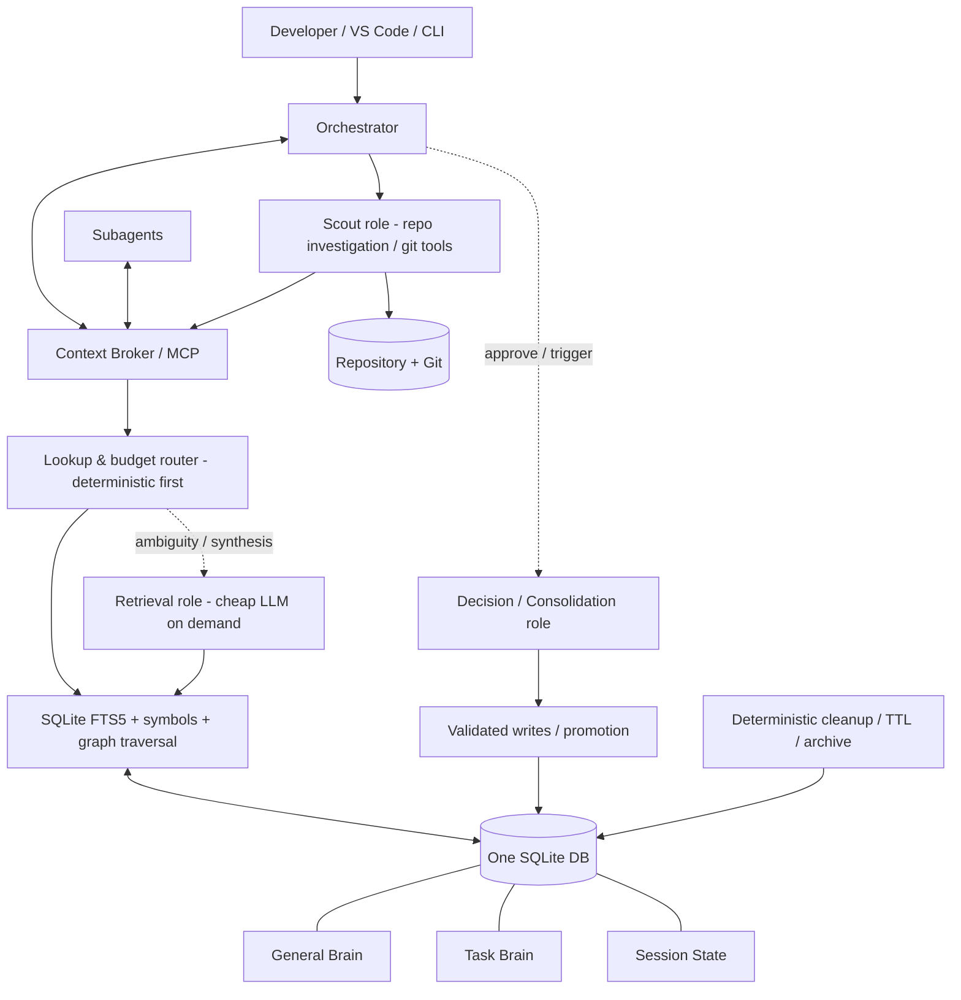

# Shared Brain — Arhitectură v0.2

**Data:** 13 noiembrie 2026  
**Status:** propunere de design / RFC; neimplementat  
**Continuă:** `Shared_Brain_Architecture_v0.1.md`  
**Decizia principală:** **General Brain + Task Brain + Session State**, în aceeași bază SQLite; **Git nu mai este un subsistem al Shared Brain**, ci un instrument folosit la nevoie de Scout.

> **Scop:** orchestratorii și subagenții să poată relua munca fără să redescopere repository-ul, fără să-și transfere integral istoricul conversațiilor și fără ca memoria să devină un depozit necontrolat.

---

## 1. Ce rezolvăm

Într-un harness de coding (VS Code, Copilot, Claude Code, Codex sau alt mediu), subagenții pornesc adesea fără întregul context al orchestratorului. În consecință:

- investighează repetat aceleași funcții, module, configurații sau erori;
- pierd constrângeri și decizii stabilite anterior;
- pot repeta abordări deja eșuate;
- consumă tokenuri și timp pentru lucru deja făcut;
- la închiderea conversației se poate pierde continuitatea unei activități care durează zile.

**Shared Brain nu este un chat log și nici o copie a repository-ului.** Este un sistem de memorie cu pointeri verificabili, relații și rezumate mici, plus un serviciu care livrează contextul potrivit agentului potrivit.

**Obiectiv de experiment:** reducere a costului recurent cu aproximativ 60%, acceptând eventual un compromis de performanță de până la 10%. Aceste cifre sunt **ținte de test**, nu estimări validate. Măsurăm și timpul de execuție, numărul de explorări repetate, erorile și costul de indexare inițială.

## 2. Vocabularul final

### 2.1 General Brain — cunoștințe durabile

Conține ceea ce este reutilizabil între activități: structură de module, arhitectură, convenții, interfețe, decizii validate, probleme recurente, explicații și pointeri către surse.

- **Durată:** săptămâni, luni sau mai mult.
- **Scrieri:** controlate și consolidate periodic (de exemplu la 3–7 zile), plus promovări explicite când este cazul.
- **Citiri:** oricând, la cerere.
- **Revizie:** periodică sau declanșată de o nevoie reală; nu presupunem că orice schimbare de cod justifică o scanare totală.
- **Statut:** o cunoștință poate fi `verified`, `unverified`, `needs_review` sau `superseded`.

### 2.2 Task Brain — memorie persistentă a unei activități

**Aceasta este corecția importantă față de v0.1:** Task Brain nu expiră când închizi VS Code sau începi un chat nou. Este legat de **activitatea de lucru**, care poate dura ore, zile sau săptămâni.

Conține: obiectiv, constrângeri, subtaskuri, descoperiri ale Scout, decizii, tentative eșuate, blocaje, progres, next steps, referințe din cod și rezumate de handoff.

- **Durată:** până când taskul este încheiat și arhivat; poate traversa multe sesiuni.
- **Scrieri:** incremental, când apare o informație utilă sau un checkpoint.
- **Citiri:** pe tot parcursul activității, inclusiv în conversațiile viitoare.
- **Prioritate:** pentru contextul specific taskului, sunt prioritare descoperirile recente, dar conflictele cu General Brain trebuie verificate, nu rezolvate orbește prin regula „cel mai nou câștigă”.

### 2.3 Session State — stare efemeră de execuție

Reprezintă doar execuția curentă: ID-uri de agenți, cereri în curs, lease-uri, rezultate intermediare, cache tranzitoriu și checkpoint de execuție. Nu este o a treia memorie generală cu rezumate redundante.

- **Durată:** durata conversației / execuției; se poate recrea din Task Brain.
- **Scrieri:** dese și ieftine.
- **Final:** se păstrează doar un rezumat de handoff și dovezile relevante; restul poate expira.

| Proprietate | General Brain | Task Brain | Session State |
|---|---|---|---|
| Cheie de acces | workspace / repository / domeniu | `task_id` | `session_id` |
| Trăiește între zile? | Da | **Da** | Nu este necesar |
| Actualizare | Periodică / aprobată | La progres și checkpointuri | În timpul execuției |
| Informații | Cunoștințe stabile | Context de lucru și decizii | Stare operațională |
| Cleanup | Deduplicare + revizie | Arhivare după finalizare | TTL / expirare |
| Reutilizare | Între taskuri | Între sesiuni ale aceluiași task | În aceeași execuție |

**Implementare MVP:** un singur fișier SQLite, cu scope-uri și identificatori; nu trei baze de date și nu trei MCP servere.

---

## 3. Arhitectura v0.2



**Roluri, nu neapărat procese persistente:** Scout, Retrieval și Decision pot fi invocări separate ale aceluiași model ieftin, cu instrucțiuni și permisiuni diferite. Nu este nevoie să fie ținute „awake” între cereri. Un proces broker mic, determinist, rămâne disponibil.

### Responsabilități

| Componentă | Face | Nu face |
|---|---|---|
| Orchestrator | planifică, decide când investighează, deleagă | nu inspectează integral repo-ul pentru orice întrebare |
| Context Broker | caută, filtrează, alocă buget de tokenuri, livrează pachete | nu interpretează fără dovezi modificări complexe |
| Retrieval role | dezambiguizează, alege rezultate, rezumă cu surse | nu scrie cod și nu are terminal arbitrar |
| Scout role | inspectează repo-ul, `git diff/log/show` la cerere, raportează dovezi | nu rulează scanări Git obligatorii la fiecare request |
| Decision role | clasifică, propune promovări, reconciliază conflicte | nu șterge unilateral informații importante |
| Cleaner determinist | TTL, deduplicare exactă, arhivare, referințe nefolosite | nu „uită” decizii active |

### De ce scoatem integrarea Git

**Decizie v0.2:** fără serviciu Git integrat, fără cronologie proprie a grafului, fără snapshoturi per commit și fără reindexare obligatorie la fiecare commit.

În locul lor, instrucțiunile orchestratorului spun când să trimită Scout să investigheze Git și codul. Scout poate folosi local `git diff`, `git log`, `git show`, `git status` și doar **dacă este necesar** `git fetch` (fetch sincronizează cu remote, nu citește pur și simplu diff-ul local).

**Păstrăm totuși proveniența:** `repo`, `path`, `symbol`, `line range`, `commit` (dacă a fost observat), `observed_at`, `source_kind`. Sunt metadate ale dovezii, nu un motor de istoric Git.

**Trade-off asumat:** risc mai mare de memorie învechită față de invalidarea automată pe commit. Atenuăm prin `needs_review`, vârsta verificării, cereri explicite de validare și prioritizarea codului ca sursă de adevăr.

---

## 4. Exemplu concret: proiect DevOps pe mai multe zile

**Task:** migrarea unei pipeline Jenkins Windows „Essentials” la GitHub Actions pe runner Linux, cu optimizarea paralelizării testelor, păstrând izolarea artefactelor.

| Zi | Activitate | Ce rămâne în Task Brain |
|---|---|---|
| Luni | Scout identifică pașii Jenkins, directoarele modulelor și resursele comune | hartă, referințe, constrângeri, întrebări |
| Marți | Începe o conversație nouă; orchestratorul cere `resume_task` | checkpoint + pași următori, fără recitirea întregului chat |
| Miercuri | Agenții testează strategii de paralelizare și observă conflicte | încercări reușite/eșuate, măsurători, blocaje |
| Joi | Revenire după oprirea VS Code | progresul se reia din Task Brain |
| La final | Consolidare | cunoștințele generale validate se promovează în General Brain; Task Brain se arhivează |

**Regulă de resume:** brokerul returnează întâi 1) obiectiv, 2) decizii active, 3) constrângeri, 4) progres, 5) blocaje, 6) next steps. Detaliile tehnice se cer ulterior, la nevoie.

### Exemplu de checkpoint (ilustrativ, nu stare reală)

```yaml
task_id: devops-essentials-migration
status: in_progress
phase: parallel_execution_prototype
objective: migrate Jenkins Essentials to GitHub Actions Linux
constraints:
  - one Linux runner initially
  - preserve module output isolation
  - investigate shared test artefacts before parallel execution
decisions:
  - use separate per-module work directories
completed:
  - map Jenkins stages
  - identify shared directories
blockers:
  - determine safe concurrency around shared test assets
next_actions:
  - prototype two isolated module jobs
  - measure elapsed time and resource contention
last_checkpoint: 2026-11-13T12:00:00+02:00
```

Checkpointul este un **index scurt**, nu singura copie a informațiilor. Fiecare câmp important poate referi înregistrări detaliate cu dovezi în DB.

---

## 5. Data model: SQLite MVP

### 5.1 Reguli de modelare

- Un `workspace` poate conține mai multe repository-uri și taskuri.
- Un `task` poate avea multe sesiuni; un `session` aparține unui task sau unui context fără task explicit.
- Înregistrările de memorie au scope **general** ori **task**; Session State se stochează separat.
- O relație `edge` poate lega module, simboluri, fișiere, concepte sau memorii; nu confundăm ierarhia cu întreg graful.
- Dovezile și memoria sunt separate: o constatare poate avea mai multe surse.
- Nu copiem automat fișiere întregi în baza de date; folosim pointeri + rezumate + fragmente scurte când sunt justificate.

### 5.2 Schema SQL orientativă

```sql
PRAGMA foreign_keys = ON;
PRAGMA journal_mode = WAL;
PRAGMA busy_timeout = 5000;

CREATE TABLE workspaces (
  id TEXT PRIMARY KEY,
  name TEXT NOT NULL,
  root_path TEXT,
  created_at TEXT NOT NULL
);

CREATE TABLE tasks (
  id TEXT PRIMARY KEY,
  workspace_id TEXT NOT NULL REFERENCES workspaces(id),
  title TEXT NOT NULL,
  objective TEXT NOT NULL,
  status TEXT NOT NULL CHECK(status IN ('active','paused','done','archived')),
  checkpoint_json TEXT,
  created_at TEXT NOT NULL,
  updated_at TEXT NOT NULL,
  archived_at TEXT
);

CREATE TABLE sessions (
  id TEXT PRIMARY KEY,
  task_id TEXT REFERENCES tasks(id),
  harness TEXT,
  started_at TEXT NOT NULL,
  ended_at TEXT
);

CREATE TABLE nodes (
  id TEXT PRIMARY KEY,
  workspace_id TEXT NOT NULL REFERENCES workspaces(id),
  kind TEXT NOT NULL,             -- module, symbol, file, concept, service...
  canonical_key TEXT NOT NULL,
  display_name TEXT NOT NULL,
  metadata_json TEXT,
  UNIQUE(workspace_id, kind, canonical_key)
);

CREATE TABLE edges (
  id TEXT PRIMARY KEY,
  source_node_id TEXT NOT NULL REFERENCES nodes(id),
  target_node_id TEXT NOT NULL REFERENCES nodes(id),
  relation TEXT NOT NULL,         -- contains, calls, depends_on, configures...
  evidence_id TEXT,
  status TEXT NOT NULL DEFAULT 'unverified'
);

CREATE TABLE memories (
  id TEXT PRIMARY KEY,
  workspace_id TEXT NOT NULL REFERENCES workspaces(id),
  task_id TEXT REFERENCES tasks(id),
  scope TEXT NOT NULL CHECK(scope IN ('general','task')),
  kind TEXT NOT NULL,             -- finding, decision, constraint, failure, summary...
  title TEXT NOT NULL,
  body TEXT NOT NULL,
  status TEXT NOT NULL DEFAULT 'unverified',
  confidence REAL,
  pinned INTEGER NOT NULL DEFAULT 0,
  created_at TEXT NOT NULL,
  updated_at TEXT NOT NULL,
  verified_at TEXT,
  supersedes_id TEXT REFERENCES memories(id),
  CHECK((scope='task' AND task_id IS NOT NULL) OR
        (scope='general' AND task_id IS NULL))
);

CREATE TABLE evidence (
  id TEXT PRIMARY KEY,
  memory_id TEXT REFERENCES memories(id),
  repo_key TEXT,
  path TEXT,
  symbol TEXT,
  line_start INTEGER,
  line_end INTEGER,
  commit_sha TEXT,                -- optional pointer, not Git tracking
  source_kind TEXT NOT NULL,      -- repo, git_diff, test, agent_observation, user...
  observed_at TEXT NOT NULL,
  excerpt TEXT
);

CREATE TABLE session_state (
  session_id TEXT NOT NULL REFERENCES sessions(id),
  state_key TEXT NOT NULL,
  state_json TEXT NOT NULL,
  expires_at TEXT,
  PRIMARY KEY(session_id, state_key)
);

CREATE TABLE cache_entries (
  cache_key TEXT PRIMARY KEY,
  workspace_id TEXT NOT NULL REFERENCES workspaces(id),
  task_id TEXT REFERENCES tasks(id),
  result_json TEXT NOT NULL,
  created_at TEXT NOT NULL,
  expires_at TEXT,
  source_fingerprint TEXT
);

CREATE TABLE memory_events (
  id INTEGER PRIMARY KEY AUTOINCREMENT,
  memory_id TEXT REFERENCES memories(id),
  task_id TEXT REFERENCES tasks(id),
  event_type TEXT NOT NULL,
  actor TEXT NOT NULL,
  occurred_at TEXT NOT NULL,
  details_json TEXT
);

CREATE VIRTUAL TABLE memory_fts USING fts5(
  title, body, content='memories', content_rowid='rowid'
);
-- MVP: maintain FTS with INSERT/UPDATE/DELETE triggers or explicit rebuilds.
CREATE INDEX idx_memories_task ON memories(task_id, status);
CREATE INDEX idx_memories_scope ON memories(workspace_id, scope, kind);
CREATE INDEX idx_edges_source ON edges(source_node_id, relation);
CREATE INDEX idx_edges_target ON edges(target_node_id, relation);
```

**Notă de implementare:** `edges.evidence_id` trebuie conectat la `evidence(id)` prin FK într-o migrare după crearea tabelului, sau mutat într-un tabel de asociere many-to-many `edge_evidence` (mai bun pe termen lung). Schema este punct de discuție, nu migrare SQL finalizată. FTS5 necesită întreținerea indexului și filtrare de permisiuni/scope în interogările reale.

### 5.3 Ierarhie + graf transversal

```text
Automotive
└── Modules
    ├── Reprog
    │   ├── Flash Routine
    │   └── Linker Configuration
    ├── DCM
    ├── NvM
    └── Crypto

Reprog --uses_service--> DCM
Reprog --persists_state_via--> NvM
Reprog --verifies_image_via--> Crypto
Linker Configuration --defines--> Flash Region
```

UDS este protocol, nu modul; tipul nodului trebuie să reflecte acest lucru. Nu facem o bază „3D” geometrică: structura, dependențele și perspectivele de timp sunt moduri de navigare. **Istoricul schimbărilor se inspectează prin Scout + Git, la cerere**.

---

## 6. API / protocol de context

În MVP, brokerul expune puține operații (de exemplu prin MCP). Numele sunt propuneri:

| Operație | Ce face |
|---|---|
| `task.open_or_resume` | deschide/creează taskul, returnează checkpointul scurt |
| `context.get` | livrează context relevant în limita bugetului |
| `memory.search` | caută fapte și dovezi cu filtre de scope |
| `memory.propose` | propune o descoperire/decizie cu surse |
| `task.checkpoint` | actualizează starea de handoff |
| `task.archive` | închide activitatea și pregătește consolidarea |
| `memory.promote` | promovează selectiv în General Brain, după validare |

### Exemplu: reluarea activității

```json
{
  "method": "task.open_or_resume",
  "params": {
    "workspace_id": "automotive-ci",
    "task_id": "devops-essentials-migration",
    "session_id": "2026-11-13-pm",
    "max_tokens": 900
  }
}
```

Răspunsul include `checkpoint`, `active_constraints`, `decisions`, `blockers`, `next_actions` și ID-uri de dovezi. Nu returnează toate mesajele trecute.

### Exemplu: retrieval punctual

```json
{
  "method": "context.get",
  "params": {
    "task_id": "devops-essentials-migration",
    "query": "Cum sunt organizate directoarele comune ale testelor?",
    "max_tokens": 1200,
    "scopes": ["task", "general"],
    "include_evidence": true
  }
}
```

Răspuns recomandat:

```json
{
  "summary": "Rezumat compact bazat pe dovezi...",
  "facts": [{"memory_id": "m-123", "status": "verified", "evidence_ids": ["e-12"]}],
  "open_questions": ["Trebuie verificat accesul concurent la folderul comun."],
  "needs_scout": false,
  "tokens_used_estimate": 410
}
```

**Important:** `needs_scout` este un semnal, nu o dovadă că datele sunt corecte. Orchestratorul păstrează decizia de escaladare.

---

## 7. Politica de retrieval, cache și buget de context

1. Caută exact (ID, path, simbol, tag de modul).
2. Caută lexical în FTS5.
3. Traversează relațiile relevante ale grafului, cu limită de adâncime și buget.
4. Returnează rezultate existente, cu dovezi și semnale de prospețime.
5. Apelează rolul Retrieval LLM **doar** dacă trebuie reformulată sau reconciliată cererea.
6. Dacă informația lipsește sau este suspectă, propune o investigație Scout.

**Cache pe niveluri logice:**

- **L1:** rezultatul deja disponibil în Session State / taskul curent;
- **L2:** fragmente și răspunsuri asociate Task Brain;
- **L3:** General Brain (mai stabil, dar posibil mai vechi).

Nu sunt neapărat trei tehnologii distincte. Cache key trebuie să țină cont de workspace, task, scope, query normalizat, versiunea memoriei și politica de acces. Pentru cereri simultane identice, implementăm **single-flight**: o singură cercetare, restul așteaptă rezultatul.

**Buget propus pentru teste (configurabil, nu limită absolută):** checkpoint 500–1.000 tokenuri; retrieval normal 500–1.500; extensie la 3.000–5.000 doar la cerere. Compresia gzip economisește stocare / transfer, nu tokenuri de context după decomprimare. Economiile de inferență vin din selecție, rezumare și eliminarea redundanței.

### Cost model

Cost total = cost de bootstrap + costuri per sesiune (LLM + tool-uri + overhead) + cost de mentenanță. Într-o evaluare, comparăm aceleași taskuri **cu și fără Shared Brain** și raportăm separat: input/output tokens, cost efectiv, latență, rate de succes, cercetări duplicate, riscul de context vechi. Nu presupunem o reducere automată de 60%.

---

## 8. Reguli pentru Scout și Git (fără subsistem Git central)

Scopul acestei politici este să evite atât revalidarea inutilă, cât și propagarea concluziilor expirate.

**Când se invocă Scout:**

- nu există informații relevante în memorie;
- dovezile sunt insuficiente sau contradictorii;
- taskul cere comportamentul **actual** al codului;
- o eroare nouă sugerează că presupunerile anterioare sunt greșite;
- orchestratorul solicită explicit un diff, un istoric sau o comparație.

**Instrucțiune exemplu pentru orchestrator:**

> Consultă întâi Task Brain, apoi General Brain. Dacă informația este suficientă și validă pentru scop, reutilizeaz-o. Dacă răspunsul depinde de starea curentă a repository-ului, iar dovada existentă nu este satisfăcătoare, deleagă unui Scout verificarea fișierelor relevante și, dacă este util, a diferențelor Git. Cere surse concrete; nu solicita o scanare completă fără motiv.

**Instrucțiune exemplu pentru Scout:**

> Investighează strict întrebarea primită. Începe din pointerii din memorie. Folosește căutare în cod și comenzi Git locale relevante. Returnează un rezumat scurt, lista fișierelor/simbolurilor implicate, dovezile și eventualele contradicții. Nu modifica repository-ul. `git fetch` numai dacă se cere comparație cu remote și există acces/permisiune.

**Ce nu automatizăm în v0.2:** monitorizare continuă de commituri, versiuni temporale ale tuturor muchiilor, snapshoturi ale grafului pe branch, invalidare a întregului cache la fiecare commit.

---

## 9. Consolidare, promovare și cleaner

### 9.1 În timpul taskului

Observațiile se scriu în Task Brain pe măsură ce sunt validate sau devin relevante. Nu se transferă fiecare mesaj brut. Marcăm explicit tentative nereușite, cauze și decizii pentru a preveni repetarea lor.

### 9.2 La checkpoint / la schimbarea sesiunii

- actualizăm obiectivul, progresul, blocajele și pașii următori;
- păstrăm deciziile pinned și pointerii spre surse;
- expirăm rezultate temporare care nu mai sunt necesare.

### 9.3 La 3–7 zile sau la închiderea taskului

- consolidatorul propune ce este reutilizabil în General Brain;
- duplicatele semantice sunt grupate, nu șterse automat;
- contradicțiile se marchează pentru verificare;
- faptele specifice unui task încheiat rămân în arhiva Task Brain, nu poluează General Brain;
- promovarea respectă o politică explicită de aprobare și proveniență.

### 9.4 Cleanup fără agent permanent

TTL și expunerea pentru arhivare sunt deterministe. Modelul ieftin este invocat punctual pentru deduplicare semantică, prioritizare și rezumare. **Pinned constraints, deciziile active și sursele invocate de taskuri active nu se șterg automat.** Se poate păstra un jurnal de audit (`memory_events`).

---

## 10. Calitate, securitate și concurență

- **SQLite WAL:** potrivit pentru MVP cu mulți cititori și puțini scriitori; scrierile sunt serializate. Folosim tranzacții scurte, retry la `SQLITE_BUSY`, indexuri și limitarea operațiilor grele.
- **Permisiuni și scope:** memoria unui workspace nu trebuie expusă automat altui workspace. Nu introducem secrete, tokenuri, chei sau date sensibile în memorie.
- **Proveniență:** fiecare concluzie importantă trebuie să aibă dovezi sau să fie etichetată ca ipoteză.
- **Prompt injection:** textul din repo și din rezultate Scout este **date neîncredere**, nu instrucțiuni pentru orchestrator.
- **Conflict de scriere:** `memory.propose` poate fi asincron; o validare înainte de `memory.promote` sau `supersede` protejează General Brain.
- **Portabilitate:** mecanismul funcționează dacă harness-ul poate apela MCP sau o interfață echivalentă și poate transmite `task_id`.
- **Fără presupunere de memorie automată:** dacă un harness nu transmite `task_id`, sistemul trebuie să ofere selectare explicită / rezolvare prin workspace și activitate.

---

## 11. Roadmap incremental

### Faza 0 — contract și măsurare

Alegem 5–10 taskuri reale, definim ce este „răspuns corect”, baseline fără memorie și bugetele de tokenuri. Stabilim formatul de checkpoint și API-ul.

### Faza 1 — MVP fără LLM

SQLite + FTS5, `tasks`, `sessions`, `memories`, `evidence`, `task.open_or_resume`, `context.get`, `task.checkpoint`. Demonstrație: reluarea unei activități în alt chat, fără recitire completă.

### Faza 2 — graf și Scout la cerere

Noduri, relații, pointer-first retrieval, instrucțiuni pentru Scout și confirmarea surselor. Git rămâne tool al Scout, nu serviciu central.

### Faza 3 — Retrieval / Decision low-cost

Model ieftin invocat numai la ambiguitate, consolidare și clasificare. Restrângem tool-urile și măsurăm costul per task, nu doar prețul/token.

### Faza 4 — consolidare și guardrails

Promovare Task → General, conflict detection, cleanup determinist, audit, single-flight, evaluarea prospețimii.

### Faza 5 — benchmark și integrare multi-harness

Comparație A/B pe sarcini automotive/DevOps. Abia apoi optimizăm caching-ul semantic, eventual embeddings sau reranking, **dacă** FTS5 + graf nu sunt suficiente.

---

## 12. Decizii luate vs. întrebări deschise

### Decizii de design actuale

1. O bază SQLite pentru General Brain, Task Brain și Session State.
2. **Task Brain supraviețuiește închiderii chatului/IDE-ului**, inclusiv pentru proiecte DevOps de câteva zile.
3. General Brain se consolidează periodic, nu la fiecare modificare a codului.
4. Git nu mai face parte din nucleul arhitecturii; Scout îl consultă când e nevoie.
5. Memoria păstrează pointeri și dovezi, nu dump-uri masive.
6. Retrieval și Decision sunt roluri on demand, nu procese AI permanent active.
7. Caching-ul este în primul rând determinist; LLM-ul intervine selectiv.
8. Cleaner-ul nu are voie să elimine informații pinned sau necesare taskurilor active.

### Întrebări pentru următoarea sesiune

1. **Identificarea taskului:** îl alegi manual, se deduce din branch/ticket sau se folosește un mecanism hibrid?
2. **Granularitate:** un Task Brain pentru tot proiectul DevOps sau subtaskuri copil care partajează un task părinte?
3. **Promovare:** cine aprobă intrarea în General Brain — orchestratorul, un Decision Agent sau utilizatorul în cazurile critice?
4. **Concurență:** câți agenți scriu simultan și ce garanții de consistență sunt necesare?
5. **Modelul ieftin:** ce candidat oferă cel mai bun cost/răspuns corect pe retrieval și consolidare în workload-ul real?
6. **Prospețime:** când acceptăm o memorie veche și când forțăm Scout să verifice codul?
7. **UX:** cum inspectăm vizual un Task Brain, dovezile, conflictele și consumul de tokenuri?
8. **Date sensibile:** ce nu poate fi salvat din mediile corporate și cum respectăm politicile companiei?

---

## 13. Rezumat pentru reluarea discuției

**Shared Brain v0.2 = Context Broker + SQLite + trei scope-uri logice:**

- **General Brain** oferă cunoștințe durabile, consolidate periodic.
- **Task Brain** păstrează munca în desfășurare între sesiuni, inclusiv timp de zile sau săptămâni.
- **Session State** păstrează doar execuția tranzitorie, nu întregul istoric.

Orchestratorul consultă memoria înainte de a trimite Scout să reexploreze repo-ul. Scout verifică Git și codul **la cerere**; Retrieval/Decision rulează pe modele economice doar atunci când valoarea justifică inferența. Cleaner-ul gestionează retenția fără a compromite deciziile importante. La finalul unui task, informațiile reutilizabile pot fi promovate în General Brain, iar detaliile taskului rămân arhivate.

**Primul experiment recomandat:** deschide un task DevOps, salvează trei checkpointuri și câteva dovezi, închide conversația, reia într-o sesiune nouă și măsoară cât context și câte investigații au fost economisite.