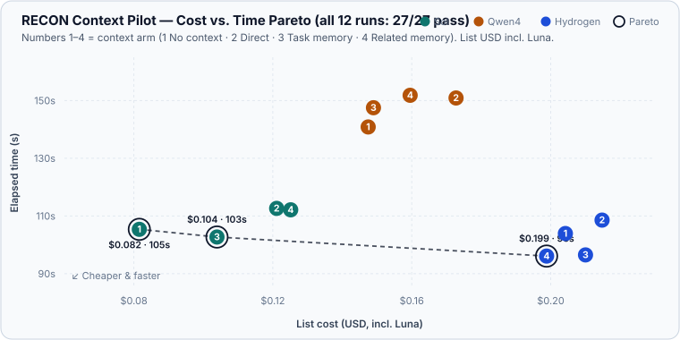

# CI Waves Context & Librarian Pilot (2026-11-13)

Controlled four-arm pilot measuring how context delivery affects **quality, tokens, list USD cost, and elapsed time** across three models (`gpt-6.1-sol`, `qwen4-max-preview`, `gemini-4-hydrogen-medium`, all effort `medium`), with `gpt-6-luna` (`medium`) as the RECON Librarian.

> **One run per cell (pilot):** this measures a single deterministic task at one point in time. It cannot separate small per-arm deltas from run-to-run variance.

## Plain-language verdict: is RECON worth it here?

- **Not on this small, self-contained task.** All 12 runs passed **27/27** sealed acceptance checks and the project quality gate—even with **zero context** (Arm 1). Because quality was already saturated at 100%, adding context or RECON could not improve correctness and mostly increased USD cost (`+1.1%` to `+53.5%`), or saved at most `3–8 s`.
- **Luna routing itself is cheap:** `gpt-6-luna` cost **$0.0009 to $0.0021 per route** (~1% of a run). Total run cost is driven by the main model's tokens, not the librarian.
- **When RECON pays off:** harder, multi-file tasks where a no-context run fails or wastes multiple rounds exploring, and larger knowledge bases where Luna filters out irrelevant sections instead of returning all 5–6 sections.

---

## Cost vs. Time Pareto Frontier

All 12 runs achieved `27/27` acceptance and `make check` pass, so the Pareto frontier compares **List USD (lower is better)** vs. **Elapsed time in seconds (lower is better)**. Only **3 of 12** runs sit on the Pareto frontier:

1. **`gpt-6.1-sol` · Arm 1 (No context):** `$0.0815` · `105.4 s` — cheapest overall.
2. **`gpt-6.1-sol` · Arm 3 (Task memory):** `$0.1039` · `102.7 s` — `2.7 s` faster than Sol Arm 1 for `+$0.0224`.
3. **`gemini-4-hydrogen-medium` · Arm 4 (Related memory):** `$0.1988` · `96.1 s` — fastest overall, ~2.4× the cost of Sol Arm 1.

---

## Experimental Setup

- **Task:** Python stdlib dry-run CI wave scheduler (`waveplan/scheduler.py` + `waveplan/__main__.py`): target prerequisite closure, deterministic greedy waves, `--max-parallel` `1..16` excluding `bool`, hierarchical resource locks, immutable inputs, and JSON CLI.
- **Sealed baseline:** commit `9c2087f`, 66 legacy tests green, 1 public feature test intentionally red, 27 hidden acceptance checks sealed outside all worker views (baseline hidden score: 4 failures, 22 errors).
- **Arms:**
  - **1 · No context:** task prompt and repository only.
  - **2 · Direct context:** fixed orchestrator handoff (6 sections, 2,947 bytes) pasted directly into the prompt.
  - **3 · Task memory:** the exact same 6 sections stored in SQLite, routed by `gpt-6-luna` and retrieved via `recon`.
  - **4 · Related memory:** 5 source-grounded sections about prior baseline components (1,847 bytes), with no task-specific handoff.
- **Isolation & integrity:** fresh sessions, separate worktrees, rotated arm order, one active run per provider, 300 s deadline, no repair rounds. Event-log audit confirmed zero out-of-worktree reads (aside from shared `uv` cache, fixture `.venv`, and `/tmp`), zero subagent/delegation calls, and exact model/effort launch flags.
- **Exploratory note (outside sealed score):** testing malformed textual/decimal `--max-parallel` (`abc`, `1.5`) post-hoc showed 11/12 runs return `invalid_parallel`, while `r03` (`gemini-4-hydrogen-medium`, Arm 4) returns `invalid_pipeline` (unrepaired).

---

## Per-Run Measurements (Tokens, List USD, Time)

**Accounting rules:**
- **Inclusive processed tokens** = `inputTokens` (including `cacheReadTokens`) + `outputTokens` (including `reasoningTokens` once).
- Provider caches were **not** forced cold; native cache counters are preserved.
- Tokenizers differ across providers—compare token counts **within each model only**.
- **List USD rates** (per 1M tokens: `fresh input / cache read / output`):
  - `gpt-6.1-sol`: `$2.00 / $0.10 / $10.00` (OpenAI list prices, 2026-11-04)
  - `gpt-6-luna`: `$0.10 / $0.01 / $0.50` (OpenAI list prices, 2026-11-04)
  - `qwen4-max-preview`: `$2.00 / $0.17 / $6.00` (Alibaba list prices, 2026-11-12; −80% promo not applied)
  - `gemini-4-hydrogen-medium`: `$1.50 / $0.075 / $7.50` (Gemini list prices, 2026-11-13)
  - `claude-opus-5.5`: `$4.00 / $0.20 / $20.00` (Anthropic API list prices, cached 2026-10-06)

| Model | Arm | Run | Impl. Tok | Uncached In | Cached In | Output | Reasoning | Luna Tok | Total Tok | Δ Tok | Impl USD | Luna USD | Total USD | Δ USD | Time | Pareto |
| --- | --- | --- | ---: | ---: | ---: | ---: | ---: | ---: | ---: | ---: | ---: | ---: | ---: | ---: | ---: | :---: |
| `gpt-6.1-sol` | 1 · No context | `r01` | 213,274 | 11,671 | 197,760 | 3,843 | 397 | — | 213,274 | baseline | $0.0815 | — | $0.0815 | baseline | 105.4 s | **Yes** |
| `gpt-6.1-sol` | 2 · Direct context | `r10` | 275,699 | 27,577 | 243,968 | 4,154 | 385 | — | 275,699 | +29.3% | $0.1211 | — | $0.1211 | +48.6% | 112.6 s | — |
| `gpt-6.1-sol` | 3 · Task memory | `r04` | 265,475 | 19,879 | 241,792 | 3,804 | 202 | 18,168 | 283,643 | +33.0% | $0.1020 | $0.0019 | $0.1039 | +27.5% | 102.7 s | **Yes** |
| `gpt-6.1-sol` | 4 · Related memory | `r07` | 296,579 | 27,907 | 264,576 | 4,096 | 354 | 18,074 | 314,653 | +47.5% | $0.1232 | $0.0019 | $0.1251 | +53.5% | 112.1 s | — |
| `qwen4-max-preview` | 1 · No context | `r08` | 404,222 | 19,157 | 377,575 | 7,490 | n/a | — | 404,222 | baseline | $0.1474 | — | $0.1474 | baseline | 140.9 s | — |
| `qwen4-max-preview` | 2 · Direct context | `r02` | 396,707 | 29,391 | 358,481 | 8,835 | n/a | — | 396,707 | −1.9% | $0.1727 | — | $0.1727 | +17.2% | 150.9 s | — |
| `qwen4-max-preview` | 3 · Task memory | `r11` | 373,359 | 21,093 | 344,384 | 7,882 | n/a | 18,260 | 391,619 | −3.1% | $0.1480 | $0.0009 | $0.1490 | +1.1% | 147.5 s | — |
| `qwen4-max-preview` | 4 · Related memory | `r05` | 395,250 | 21,964 | 364,698 | 8,588 | n/a | 19,739 | 414,989 | +2.7% | $0.1575 | $0.0021 | $0.1595 | +8.2% | 151.8 s | — |
| `gemini-4-hydrogen-medium` | 1 · No context | `r12` | 498,660 | 58,830 | 428,655 | 11,175 | 5,349 | — | 498,660 | baseline | $0.2042 | — | $0.2042 | baseline | 103.9 s | — |
| `gemini-4-hydrogen-medium` | 2 · Direct context | `r06` | 490,180 | 59,601 | 418,044 | 12,535 | 6,492 | — | 490,180 | −1.7% | $0.2148 | — | $0.2148 | +5.2% | 108.6 s | — |
| `gemini-4-hydrogen-medium` | 3 · Task memory | `r09` | 490,418 | 57,384 | 421,006 | 12,028 | 4,613 | 19,910 | 510,328 | +2.3% | $0.2079 | $0.0021 | $0.2100 | +2.8% | 96.5 s | — |
| `gemini-4-hydrogen-medium` | 4 · Related memory | `r03` | 394,841 | 54,570 | 328,238 | 12,033 | 5,880 | 19,747 | 414,588 | −16.9% | $0.1967 | $0.0021 | $0.1988 | −2.6% | 96.1 s | **Yes** |

- **Implementations total (12 runs):** `4,494,664` tokens (`$1.8771`)
- **Luna routing total (6 routes):** `113,898` tokens (`$0.0110`), `8.1–10.5 s` per route. Every route returned 100% of its corpus (`6/6` in Arm 3, `5/5` in Arm 4) because the corpora were small.

---

## Shared One-Time Setup & Orchestration Costs

These one-time setup and orchestration expenses are tracked separately and not charged to any arm:

| Item | Model · Effort | Tokens | List USD | Note |
| --- | --- | ---: | ---: | --- |
| Fixture authoring | `gpt-6.1-sol` · `medium` | 1,031,204 | $0.3412 | 66 legacy tests + baseline stub |
| Task context preparation | `gpt-6.1-sol` · `medium` | 81,965 | $0.0601 | 6 sections, 2,947 bytes |
| Related-history preparation | `gpt-6.1-sol` · `medium` | 39,220 | $0.0498 | 5 sections, 1,847 bytes |
| Preflight probes (8, incl. failed) | all 4 models · `medium` | 127,814 | $0.0796 | 1 failed Qwen probe at 0 tok |
| Parent orchestration | `gpt-6.1-sol` · **`xhigh`** | 16,436,197 | $3.1147 | final through handoff |
| Cockpit UX worker (cancelled) | `gemini-4-hydrogen-medium` · `medium` | 1,671,625 | $0.4152 | partial (24 completed calls) |
| Continuation review & publish | `claude-opus-5.5` · `medium` | 7,478,716 | $0.9839 | snapshot prior to final docs |

Total shared setup & orchestration: **`26,866,741` tokens (`$5.0445`)**, compared to **`$1.8882`** for all 12 implementations + 6 Luna routes combined.
