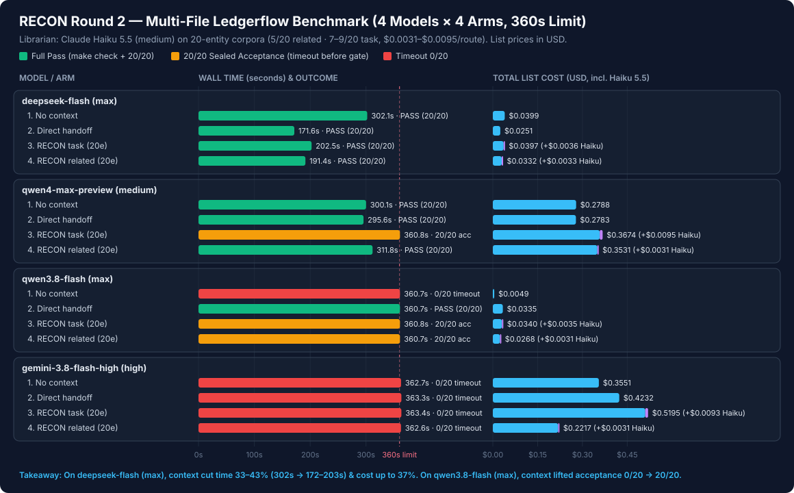

# RECON Round 2 Benchmark — Multi-File Ledgerflow Settlement (2026-11-13)

## Setup
- **Task (`ledgerflow`):** Multi-file Python feature across 4 modules (`tax.py`, `credits.py`, `reconcile.py`, `__main__.py`): progressive marginal tax with single end quantization, FIFO credit allocation with `currency_mismatch` checks, atomic multi-currency batch settlement with `0.02` tolerance and FX gain/loss, and `settle-batch` CLI with coded JSON errors.
- **Contestants (4 models × 4 rotated arms = 16 fresh runs, 360 s wall-time limit):**
  - `deepseek-flash` (`dshw`, effort `max`)
  - `qwen4-max-preview` (`qwen`, effort `medium`)
  - `qwen3.8-flash` (`qwen`, effort `max`)
  - `gemini-3.8-flash-high` (`agy`, effort `high`)
- **Librarian (Arms 3 & 4, 8 routes):** `claude-haiku-5-5` (`medium`) routing over **20-entity** RECON corpora (`task-corpus`: 6 relevant + 14 distractors; `related-corpus`: 5 relevant baseline notes + 15 distractors).
- **Evaluation gate:** Offline `make check` (`ruff format --check`, `ruff check`, `pyright`, `pytest`, `compileall`) plus **20 sealed acceptance tests** (`acceptance.py`), verified 20/20 on an independent oracle before launching contestants.

## Plain-Language Verdict: Is RECON Worth It Here?
**Yes — when the task is complex enough that models either lose time searching or fail without guidance, and when the corpus has real distractor noise:**
- **`deepseek-flash` (`max`) — 4/4 Full Pass, 33%–43% faster with context:** Without context (`no-context`), it passed in `302.1 s` (`$0.0399`). With `direct-handoff` it dropped to `171.6 s` (`-43%`, `$0.0251`, `-37%` cost); with `recon-related` to `191.4 s` (`-37%`, `$0.0332`); with `recon-task` to `202.5 s` (`-33%`, `$0.0397`).
- **`qwen3.8-flash` (`max`) — Context rescued acceptance from `0/20` to `20/20`:** Without context, it stalled in `tax.py` and scored `0/20` at the 360 s timeout. With any of the 3 context arms (`direct-handoff`, `recon-task`, `recon-related`), it reached **`20/20` sealed acceptance** (`direct-handoff` also passed `make check`; `recon-task` and `recon-related` failed only formatting/lint on their own new tests right at the 360 s cutoff).
- **`qwen4-max-preview` (`medium`) — `20/20` acceptance on all 4 arms:** `no-context` (`300.1 s`, `$0.2788`), `direct-handoff` (`295.6 s`, `$0.2783`), and `recon-related` (`311.8 s`, `$0.3531`) passed `make check` + `20/20`; `recon-task` reached `20/20` sealed acceptance at `360.8 s` with 1 self-test failure (`30/31`).
- **`gemini-3.8-flash-high` (`high`) — `0/20` across all 4 arms:** All 4 runs hit `agy` `DEADLINE_EXCEEDED` (`print_timeout` at `360 s`) before completing edits.
- **Haiku 5.5 Librarian Selectivity (20-entity corpora):** On `recon-related`, Haiku selected **`5/20`** entities on all 4 runs (`$0.0031–$0.0033` per route). On `recon-task`, Haiku selected **`7–9/20`** entities (`$0.0035–$0.0095` per route), filtering out 55%–75% of irrelevant distractor entries.

## Full 16-Run Measurements

| Run | Model (Effort) | Arm | Status | Time | `make check` | Sealed Acc | Uncached In | Cache Read | Output | Haiku Selectivity | Haiku USD | Total USD |
| :-- | :-- | :-- | :-- | --: | :-- | --: | --: | --: | --: | --: | --: | --: |
| `r01` | `gemini-3.8-flash-high` (high) | `no-context` | failed | 362.7s | FAIL | 0/20 | 85,581 | 465,007 | 25,577 | — | — | **$0.3551** |
| `r02` | `gemini-3.8-flash-high` (high) | `direct-handoff` | failed | 363.3s | FAIL | 0/20 | 101,079 | 608,635 | 30,120 | — | — | **$0.4232** |
| `r03` | `gemini-3.8-flash-high` (high) | `recon-task` | failed | 363.4s | FAIL | 0/20 | 116,783 | 892,336 | 35,752 | 7/20 | $0.0093 | **$0.5195** |
| `r04` | `gemini-3.8-flash-high` (high) | `recon-related` | failed | 362.6s | FAIL | 0/20 | 103,554 | 583,510 | 2,604 | 5/20 | $0.0031 | **$0.2217** |
| `r05` | `qwen4-max-preview` (medium) | `direct-handoff` | completed | 295.6s | PASS | 20/20 | 43,559 | 362,653 | 21,587 | — | — | **$0.2783** |
| `r06` | `qwen4-max-preview` (medium) | `recon-task` | failed | 360.8s | FAIL | 20/20 | 44,163 | 759,614 | 23,401 | 7/20 | $0.0095 | **$0.3674** |
| `r07` | `qwen4-max-preview` (medium) | `recon-related` | completed | 311.8s | PASS | 20/20 | 39,705 | 845,559 | 21,127 | 5/20 | $0.0031 | **$0.3531** |
| `r08` | `qwen4-max-preview` (medium) | `no-context` | completed | 300.1s | PASS | 20/20 | 35,373 | 448,554 | 21,966 | — | — | **$0.2788** |
| `r09` | `qwen3.8-flash` (max) | `recon-task` | failed | 360.8s | FAIL | 20/20 | 48,815 | 525,948 | 31,444 | 9/20 | $0.0035 | **$0.0340** |
| `r10` | `qwen3.8-flash` (max) | `recon-related` | failed | 360.7s | FAIL | 20/20 | 37,177 | 521,123 | 20,880 | 5/20 | $0.0031 | **$0.0268** |
| `r11` | `qwen3.8-flash` (max) | `no-context` | failed | 360.7s | FAIL | 0/20 | 12,509 | 142,899 | 1,599 | — | — | **$0.0049** |
| `r12` | `qwen3.8-flash` (max) | `direct-handoff` | failed | 360.7s | PASS | 20/20 | 46,912 | 783,914 | 29,583 | — | — | **$0.0335** |
| `r13` | `deepseek-flash` (max) | `recon-related` | completed | 191.4s | PASS | 20/20 | 43,893 | 1,809,792 | 29,760 | 5/20 | $0.0033 | **$0.0332** |
| `r14` | `deepseek-flash` (max) | `no-context` | completed | 302.1s | PASS | 20/20 | 25,211 | 1,382,400 | 53,225 | — | — | **$0.0399** |
| `r15` | `deepseek-flash` (max) | `direct-handoff` | completed | 171.6s | PASS | 20/20 | 25,481 | 1,144,960 | 29,695 | — | — | **$0.0251** |
| `r16` | `deepseek-flash` (max) | `recon-task` | completed | 202.5s | PASS | 20/20 | 63,112 | 1,786,752 | 35,484 | 7/20 | $0.0036 | **$0.0397** |

## List Prices Used (`$/1M` tokens)
- `deepseek-flash` (off-peak UTC): `$0.15` uncached input, `$0.003` cache read, `$0.60` output
- `qwen4-max-preview`: `$2.00` uncached input, `$0.17` cache read, `$6.00` output
- `qwen3.8-flash`: `$0.15` uncached input, `$0.016` cache read, `$0.47` output
- `gemini-3.8-flash-high`: `$1.50` uncached input, `$0.075` cache read, `$7.50` output
- `claude-haiku-5-5` (Librarian): `$0.10` input, `$0.125` cache write 5m, `$0.01` cache read, `$0.50` output (native `modelUsage.costUSD`)
